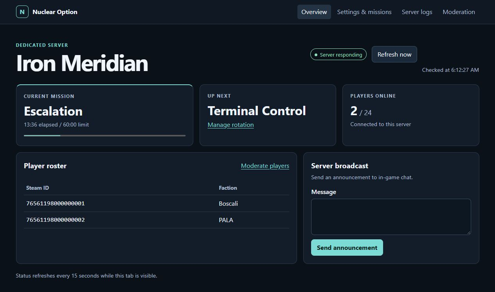
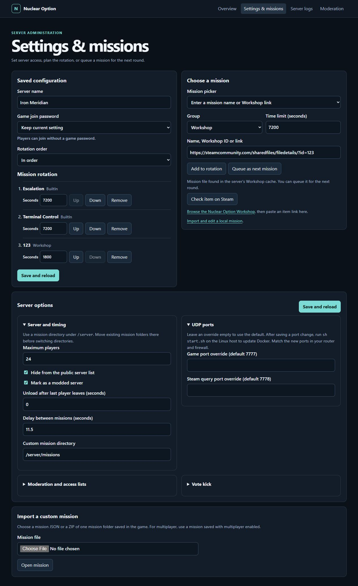
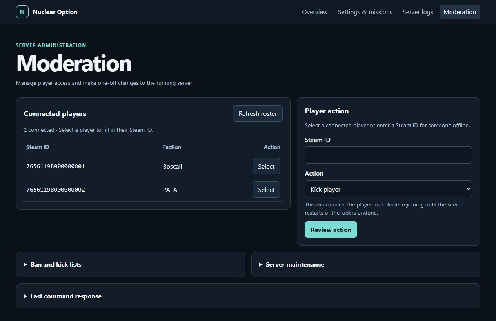

# Nuclear Option All-in-One

Run the official Nuclear Option dedicated server on an x86-64 Linux host and manage it from a browser on your LAN. Docker Compose runs the game server and this project's web panel, which uses Shockfront's command backend.

- **One-command start.** The launcher creates the initial server configuration, generates a panel password, and starts both containers. SteamCMD checks for game updates when the server container starts.
- **Server settings.** Set a game join password, player limit, visibility, mission timing, vote-kick rules, ban lists, and game or query port overrides.
- **Mission rotation.** Choose built-in missions, import and edit a local JSON or ZIP, or add a Steam Workshop item. Review and install the mission's server mods and maps from the same catalog NOMM uses.
- **Mod management.** See which missions use each mod, review dependency changes before updating, and pin exact versions in separate saved sets. Record requirements for local scenarios.
- **Moderation.** See connected players by Steam display name and ID. Select a player or enter an ID to kick, ban, or restore access.
- **LAN admin access.** Open `http://LINUX_LAN_IP:5000` from your browser. The game's remote-command port stays inside the stack.
- **Live server logs.** Check Steam updates, game startup, and mission-loading messages under **Server logs**.
- **Configurable storage.** Game files, settings, and custom missions live in `./server` by default. Set `SERVER_DATA_DIR` in `.env` to choose another host folder.

## Quick start

On an x86-64 Linux host with Docker Engine, Docker Compose, and Python 3, run:

```sh
git clone https://github.com/AlexStapleton/Nuclear-Option-All-In-One.git
cd Nuclear-Option-All-In-One
sh start.sh
```

Open the web panel from any device on your LAN. On the sign-in page, enter `admin` and the password in `.panel.env`. To change the panel address, port, or storage folder, copy `.env.example` to `.env`, edit it, and rerun `sh start.sh`. See the [setup guide](SETUP.md) for configuration and migration steps.

## Screenshots

**Overview** shows the current mission, the next mission, the player roster, and the announcement form.



**Settings & missions** shows the rotation, Workshop download status, server options, and local mission import.



**Moderation** brings the connected player list, player actions, and maintenance tools together.



The screenshots use demo server data.

## Ports and router setup

Use `docker compose ps` to check that the game container publishes both **UDP** ports. Give the Linux host a stable LAN address, such as a DHCP reservation. For internet play, forward each game port to the same port on that host and allow the traffic through the router and any host firewall. [Shockfront's port defaults](https://github.com/Shockfront-Studios/Nuclear-Option-Server-Tools/blob/main/DedicatedServerGuide.md#how-to-run-server)

| Port | Purpose | Router exposure |
| --- | --- | --- |
| `7777/udp` | Gameplay | Forward for internet play |
| `7778/udp` | Steam server browser queries | Forward for internet play |
| `5000/tcp` by default | Web admin panel (`PANEL_PORT`) | Trusted LAN only |
| `7779/tcp` | Game remote commands | Internal to the Docker stack |

If you override the game or query port in **Settings & missions**, run `sh start.sh` after saving. Use the new UDP ports in your router and firewall rules.

### OPNsense IPv4 example

Create a **Port** alias named `NuclearOption_UDP` with `7777` and `7778` as separate entries. Use your Linux host's LAN IPv4 address for `SERVER_LAN_IP` below.

1. In **Firewall → NAT → Destination NAT**, add an IPv4 UDP forward on `WAN`. Match `WAN address` and destination port `NuclearOption_UDP`, then redirect to `SERVER_LAN_IP`. Set **Redirect Target Port** to `any` to preserve the incoming port. Set **Firewall rule** to `Manual` if using the next step. You can also make two separate forwards with explicit `7777 → 7777` and `7778 → 7778` mappings. [OPNsense Destination NAT](https://docs.opnsense.org/manual/nat.html#destination-nat-port-forward) · [OPNsense 26.7 redirect-port behavior](https://github.com/opnsense/core/blob/26.7.6/src/opnsense/mvc/app/controllers/OPNsense/Firewall/forms/dialogDNatRule.xml)
2. In **Firewall → Rules → WAN**, add an IPv4 UDP **Pass** rule from `any` to `SERVER_LAN_IP`, destination port `NuclearOption_UDP`. The filter sees the translated destination address. Save and apply. [OPNsense firewall rule association](https://docs.opnsense.org/manual/nat.html#firewall-rule)
3. If the game browser on your LAN queries your public IPv4 address, add `LAN` alongside `WAN` on the IPv4 forward and make sure the LAN firewall allows the matching traffic. For a PC and server on the same subnet, add a **Source NAT** rule on `LAN`. Match IPv4 UDP, source `LAN network`, source port `any`, destination `SERVER_LAN_IP`, and destination port `NuclearOption_UDP`. Set **Translate Source IP** to `LAN address`. In automatic Source NAT mode, switch to **Hybrid** to add the rule while retaining automatic rules. Save and apply. [OPNsense hairpin NAT guide](https://docs.opnsense.org/manual/how-tos/nat_reflection.html)

Refresh the Multiplayer browser at home and have someone on a different network try joining. Those checks exercise different paths. A direct LAN response on `7778` confirms the game query service, while a response to the public address from the same LAN also checks hairpin NAT. [Shockfront's server browser troubleshooting](https://github.com/Shockfront-Studios/Nuclear-Option-Server-Tools/blob/main/DedicatedServerGuide.md#troubleshooting)

## Upgrading an existing install

Run `git pull` and `sh start.sh` from the project folder, then refresh the web panel. **Overview** shows live status and sends announcements. **Settings & missions** edits the saved configuration and queues missions. **Moderation** handles player access and one-off maintenance commands.

## Credits

This is a community project. Steam supplies the official game server as app `3930080`. This repository contains the panel interface and sign-in code. The Docker build fetches a pinned copy of Shockfront's Server Control Panel for the game command endpoints and the connection to the game. [Panel Dockerfile](panel/Dockerfile) · [Pinned Shockfront source](https://github.com/Shockfront-Studios/Nuclear-Option-Server-Tools/tree/1d3aba8af001abe2a380b3518753e0d1aef397a1/ServerControlPanel)

This project's code is licensed under MIT. Shockfront's downloaded code and the game server are separate upstream components. [Project license](LICENSE)
